<div align="center">

<!-- CUSTOM ANIMATED CYBER TERMINAL HEADER -->


#  Namaste & Welcome to My Universe!

### 💫 Passionate Software Engineer • AI Systems Architect • Cybersecurity Researcher

<!-- ANIMATED TYPING SVG -->
<p align="center">
  <a href="https://readme-typing-svg.demolab.com">
    
  </a>
</p>

<!-- SOCIAL & QUICK LINKS -->
<p align="center">
  <a href="https://www.linkedin.com/in/ranaharsh0521"></a>
  <a href="https://github.com/ranaharsh0521"></a>
  <a href="mailto:harshilrana0521@gmail.com"></a>
  <a href="https://github.com/ranaharsh0521?tab=repositories"></a>
</p>

<!-- DYNAMIC RANDOM QUOTE WIDGET -->
<p align="center">
  
</p>

</div>

---

### 💬 Words I Live & Code By

> 💡 **“Any fool can write code that a computer can understand. Good programmers write code that humans can understand.”**  
> *— Martin Fowler*

> 🛡️ **“Security is not a product, but a process.”**  
> *— Bruce Schneier*

> ⚡ **“Simplicity is prerequisite for reliability.”**  
> *— Edsger W. Dijkstra*

> 🤖 **“The question isn't whether AI is smart enough to replace programmers, but whether programmers are smart enough to harness AI to build wonders.”**

---

### 👨‍💻 About Me & My Vision

```yaml
engineer:
  name: Harshil Rana
  role: Software Developer & Systems Engineer
  focus_areas:
    - AI & Multi-Agent Distributed Architectures
    - Deep Learning & Temporal Graph Neural Networks (TGNN)
    - Cybersecurity, Intrusion Detection & Threat Defense
    - High-Throughput Full-Stack Web Platforms
  current_mission:
    - Designing intelligent software that solves real-world operational challenges
    - Building fault-tolerant, type-safe, and self-healing backend microservices
  fun_fact: "I turn caffeine and complex requirements into production-ready software."
```

---

### 🎨 Tech Stack & Superpowers

<div align="center">

#### 🚀 Languages
<p>
  
  
  
  
  
  
  
</p>

#### 🧠 AI, ML & Multi-Agent Systems
<p>
  
  
  
  
  
  
</p>

#### ⚡ Backend, Real-Time & Microservices
<p>
  
  
  
  
  
  
</p>

#### 💻 Frontend & Modern UI
<p>
  
  
  
  
  
  
</p>

#### 🗄️ Databases, Caching & Cloud
<p>
  
  
  
  
  
  
  
</p>

</div>

---

### 🔥 Signature Projects Showcase

<table>
  <tr>
    <td width="50%" valign="top">
      <h3>📈 <a href="https://github.com/ranaharsh0521/Autobot">HARSH TRADER AI</a></h3>
      <p><em>Autonomous Multi-Agent Indian Stock Market Intelligence Engine</em></p>
      <p>🔗 <strong>URL:</strong> <a href="https://github.com/ranaharsh0521/Autobot">https://github.com/ranaharsh0521/Autobot</a></p>
      <ul>
        <li>🤖 Multi-agent consensus mechanism evaluating live stock feeds.</li>
        <li>⚡ Ultra low-latency WebSockets streaming realtime orderflow & signals.</li>
        <li>📊 React + Vite terminal interface with automated risk guardrails.</li>
      </ul>
      <p>
        
        
        
        
      </p>
    </td>
    <td width="50%" valign="top">
      <h3>🛡️ <a href="https://github.com/ranaharsh0521/Asset-Analyzer">AI Cyber Attack Prediction (TGNN)</a></h3>
      <p><em>Temporal Graph Neural Networks for Next-Gen SOC Threat Defense</em></p>
      <p>🔗 <strong>URL:</strong> <a href="https://github.com/ranaharsh0521/Asset-Analyzer">https://github.com/ranaharsh0521/Asset-Analyzer</a></p>
      <ul>
        <li>🔬 Temporal Graph Neural Network trained on CICIDS2017 datasets.</li>
        <li>🌐 Interactive React SOC dashboard with node topology & MITRE mapping.</li>
        <li>🚀 High-speed FastAPI inference pipeline with Express + PostgreSQL backend.</li>
      </ul>
      <p>
        
        
        
        
      </p>
    </td>
  </tr>
  <tr>
    <td width="50%" valign="top">
      <h3>🔍 <a href="https://github.com/ranaharsh0521/CodeGuardAi">CodeGuard AI</a></h3>
      <p><em>AI-Powered Automated Code Vulnerability & Security Scanner</em></p>
      <p>🔗 <strong>URL:</strong> <a href="https://github.com/ranaharsh0521/CodeGuardAi">https://github.com/ranaharsh0521/CodeGuardAi</a></p>
      <ul>
        <li>🔎 Static code analyzer discovering critical CVEs, code smells, & bugs.</li>
        <li>💡 AI-assisted automatic code remediation and fix generation.</li>
        <li>📈 Live scan analytics, team dashboards, and WebSocket progress updates.</li>
      </ul>
      <p>
        
        
        
        
      </p>
    </td>
    <td width="50%" valign="top">
      <h3>🍲 <a href="https://github.com/ranaharsh0521/Recipe-Manager---AI-Powered-MERN-Stack-Application-v2.0">AI Recipe Manager v2.0</a></h3>
      <p><em>Full-Stack MERN Platform with Intelligent Culinary AI Engine</em></p>
      <p>🔗 <strong>URL:</strong> <a href="https://github.com/ranaharsh0521/Recipe-Manager---AI-Powered-MERN-Stack-Application-v2.0">https://github.com/ranaharsh0521/Recipe-Manager---AI-Powered-MERN-Stack-Application-v2.0</a></p>
      <ul>
        <li>🍳 AI-driven recipe generation, dynamic ingredient scaling, & nutrition charts.</li>
        <li>🔐 Secure JWT role authentication, cloud image upload, and search filters.</li>
        <li>✨ Full responsive UX crafted with React and optimized Node/Express backend.</li>
      </ul>
      <p>
        
        
        
        
      </p>
    </td>
  </tr>
  <tr>
    <td width="50%" valign="top">
      <h3>💼 <a href="https://github.com/ranaharsh0521/FundsroomChallenge">Mini ERP + CRM Portal</a></h3>
      <p><em>Production-Style Enterprise Operations & Resource Engine</em></p>
      <p>🔗 <strong>URL:</strong> <a href="https://github.com/ranaharsh0521/FundsroomChallenge">https://github.com/ranaharsh0521/FundsroomChallenge</a></p>
      <ul>
        <li>📊 Integrated enterprise workflows for customer lifecycle, leads, and financials.</li>
        <li>🔐 Modular role-based authorization (RBAC) with secure session handling.</li>
        <li>⚡ Real-time audit logs, high-throughput data tables, and analytics reporting.</li>
      </ul>
      <p>
        
        
        
      </p>
    </td>
    <td width="50%" valign="top">
      <h3>🍯 <a href="https://github.com/ranaharsh0521/Honey-Net">Honey-Net Security Platform</a></h3>
      <p><em>Decoy Network & Threat Intelligence Emulation System</em></p>
      <p>🔗 <strong>URL:</strong> <a href="https://github.com/ranaharsh0521/Honey-Net">https://github.com/ranaharsh0521/Honey-Net</a></p>
      <ul>
        <li>🛡️ Distributed honeypot architecture capturing unauthorized probing and exploits.</li>
        <li>🚨 Automated attacker payload extraction, intrusion logging, & behavioral profiling.</li>
        <li>📑 Actionable threat intelligence reports to reinforce perimeter defenses.</li>
      </ul>
      <p>
        
        
        
      </p>
    </td>
  </tr>
</table>

---

### 📂 All Repositories & Projects Directory

| Project Name | Domain / Category | Tech Stack | Repository URL (Clickable) |
| :--- | :--- | :--- | :--- |
| **HARSH TRADER AI** | Autonomous Trading Engine | FastAPI, React, Vite, WebSockets | [https://github.com/ranaharsh0521/Autobot](https://github.com/ranaharsh0521/Autobot) |
| **TGNN Cyber Defense** | Temporal Graph Neural Networks | PyTorch, FastAPI, React, PostgreSQL | [https://github.com/ranaharsh0521/Asset-Analyzer](https://github.com/ranaharsh0521/Asset-Analyzer) |
| **CodeGuard AI** | Automated Vulnerability Scanner | Next.js, FastAPI, Python AST, Tailwind | [https://github.com/ranaharsh0521/CodeGuardAi](https://github.com/ranaharsh0521/CodeGuardAi) |
| **AI Recipe Manager v2.0** | Full-Stack Culinary AI Platform | MongoDB, Express, React, Node.js | [https://github.com/ranaharsh0521/Recipe-Manager---AI-Powered-MERN-Stack-Application-v2.0](https://github.com/ranaharsh0521/Recipe-Manager---AI-Powered-MERN-Stack-Application-v2.0) |
| **Fundsroom ERP / CRM** | Operations & Business Portal | TypeScript, React, Tailwind CSS | [https://github.com/ranaharsh0521/FundsroomChallenge](https://github.com/ranaharsh0521/FundsroomChallenge) |
| **Honey-Net Security** | Honeypot & Threat Intel Decoy | Cybersecurity, Intrusion Logging, Shell | [https://github.com/ranaharsh0521/Honey-Net](https://github.com/ranaharsh0521/Honey-Net) |
| **MarketTunner** | AI Automation Platform | TypeScript, Full-Stack Web | [https://github.com/ranaharsh0521/MarketTunner](https://github.com/ranaharsh0521/MarketTunner) |
| **Invoice Processing System** | Intelligent Document Processing | Python, Document AI, OCR | [https://github.com/ranaharsh0521/Invoice-Processing-System](https://github.com/ranaharsh0521/Invoice-Processing-System) |
| **.Net Calculator** | Desktop System Application | C#, .NET Framework | [https://github.com/ranaharsh0521/.Net-calculator](https://github.com/ranaharsh0521/.Net-calculator) |
| **Calculator-.Net** | Mathematics Engine | C#, .NET Architecture | [https://github.com/ranaharsh0521/Calculator-.Net](https://github.com/ranaharsh0521/Calculator-.Net) |
| **Windows Calculator** | UI Utility Application | C#, Windows Forms | [https://github.com/ranaharsh0521/-windows-Calculater-](https://github.com/ranaharsh0521/-windows-Calculater-) |
| **OBISIB Machine Learning** | ML Predictive Models & Analytics | Jupyter Notebook, Python, Pandas | [https://github.com/ranaharsh0521/OBISIB](https://github.com/ranaharsh0521/OBISIB) |
| **AI Web Platform (My First Project)** | Web Application with AI | Full-Stack, AI API Integration | [https://github.com/ranaharsh0521/my-first-project](https://github.com/ranaharsh0521/my-first-project) |
| **Harshil Rana Profile Core** | GitHub Profile Ecosystem | Markdown, SVG, GitHub Actions | [https://github.com/ranaharsh0521/ranaharsh0521](https://github.com/ranaharsh0521/ranaharsh0521) |

---

### 📊 Live GitHub Activity & Analytics

<div align="center">
  <!-- GITHUB STATS & TOP LANGS CARDS (RADICAL CYBERPUNK THEME) -->
  
  
</div>

<div align="center" style="margin-top: 15px;">
  <!-- STREAK STATS (RADICAL THEME) -->
  
</div>

<div align="center" style="margin-top: 20px;">
  <!-- RETRO CONTRIBUTIONS SNAKE ANIMATION -->
  <picture>
    <source media="(prefers-color-scheme: dark)" srcset="https://raw.githubusercontent.com/ranaharsh0521/ranaharsh0521/output/github-contribution-grid-snake-dark.svg" />
    <source media="(prefers-color-scheme: light)" srcset="https://raw.githubusercontent.com/ranaharsh0521/ranaharsh0521/output/github-contribution-grid-snake.svg" />
    
  </picture>
</div>

---

### ⚡ The Hacker & Engineer Mindset

```python
import intelligence

class Developer:
    def __init__(self):
        self.developer = "Harshil Rana"
        self.state_of_mind = "Always Innovating"
        self.code_ethos = [
            "Write code that solves real human problems",
            "Make security and resilience first-class citizens",
            "Continuous learning and aggressive curiosity"
        ]

    def build_future(self, challenge):
        solution = intelligence.synthesize(challenge)
        return solution.deploy_with_excellence()
```

---

<div align="center">

### 🤝 Let's Connect & Build Something Legendary!

I'm always open to discussing cutting-edge AI, cybersecurity defense, and groundbreaking software projects.

[](https://www.linkedin.com/in/ranaharsh0521)
[](https://twitter.com/ranaharsh0521)
[](mailto:harshilrana0521@gmail.com)

<br/>

<!-- CUSTOM ANIMATED CYBER HUD FOOTER -->


</div>
